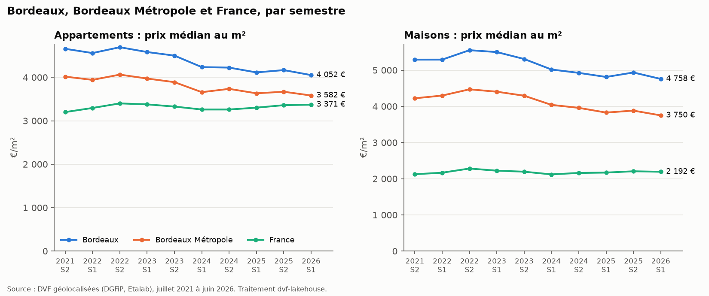
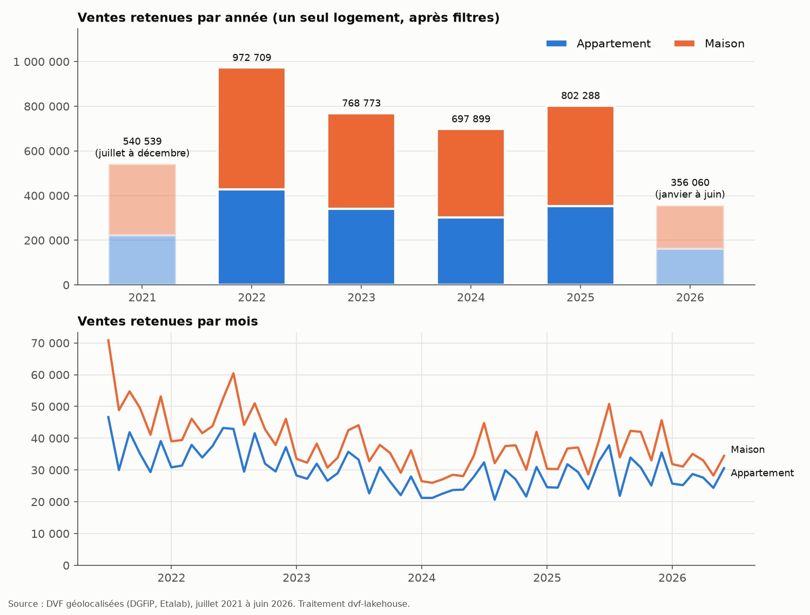
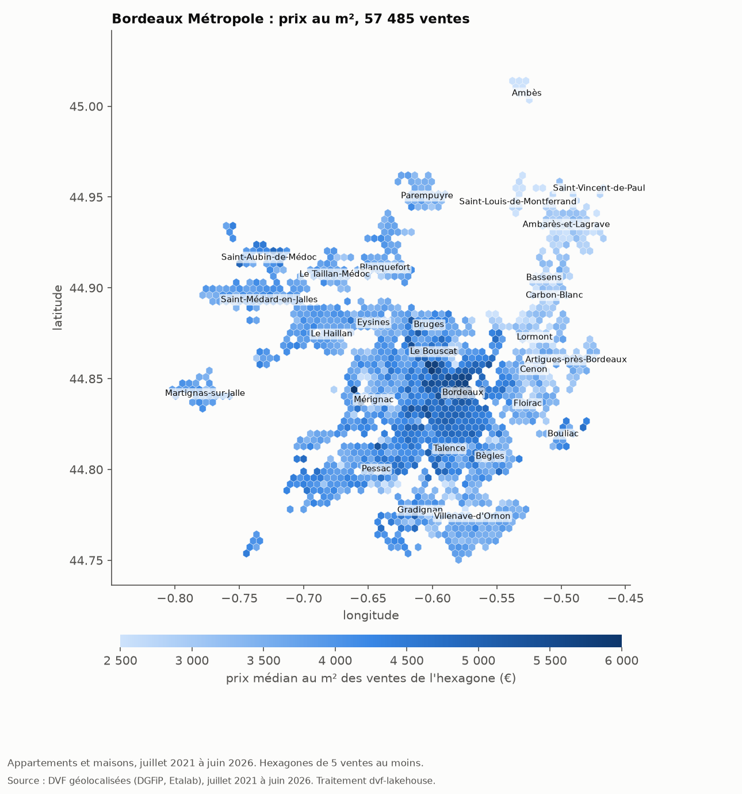
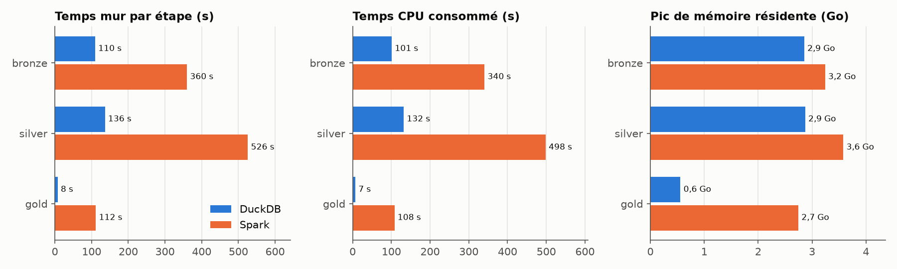

# dvf-lakehouse

Un lakehouse local sur toutes les ventes immobilières publiées en France depuis juillet 2021 (fichiers DVF géolocalisés d'Etalab), avec le même pipeline écrit deux fois : en PySpark (API DataFrame) et en DuckDB (SQL). Les deux moteurs produisent les mêmes tables, un test le vérifie, et un benchmark mesure ce que chacun coûte sur une machine ordinaire.

La question de départ était simple : à 20 millions de lignes, sur un portable, Spark vaut-il encore sa JVM ? Réponse chiffrée plus bas.

Dépôt : https://github.com/pinpin-http/dvf-lakehouse

Ce que donnent les mesures, sur le jeu complet :

- 20 065 182 lignes DVF, regroupées en 7 302 732 mutations, dont 4 138 268 ventes d'un seul logement gardées après nettoyage.
- Spark et DuckDB sortent des tables gold identiques : mêmes lignes, mêmes comptes, médianes égales au bit près. Seul le score MAD du silver diffère, de 2,9 × 10⁻¹⁰ en relatif au plus.
- Le pipeline complet prend 4 min 14 s avec DuckDB et 16 min 37 s avec Spark, sur un cœur plafonné. DuckDB consomme aussi 3,9 fois moins de temps CPU.
- Un appartement bordelais s'est vendu 4 136 €/m² en 2025 (médiane), 11 % de moins qu'au second semestre 2021 (4 657 €/m²).

## Les données

Source : [Demandes de valeurs foncières géolocalisées](https://www.data.gouv.fr/datasets/demandes-de-valeurs-foncieres-geolocalisees), publiées par Etalab à partir des données DVF de la DGFiP. Publication utilisée : octobre 2026, soit six fichiers annuels (`full-2021-s2.csv.gz` à `full-2026-s1.csv.gz`, 610 Mo compressés). Les URLs, tailles et sommes SHA-1 sont figées dans `src/dvf_lakehouse/config.py` ; `make download` ne retélécharge pas un fichier déjà présent et intègre, et `python -m dvf_lakehouse.download --lister` affiche les ressources du moment quand Etalab publie une nouvelle livraison.

Couverture réelle : de juillet 2021 à juin 2026. 2021 et 2026 ne sont donc couverts que sur six mois. 2020 n'est plus téléchargeable : la DGFiP ne publie que les cinq dernières années, et l'archive d'avril 2026 (qui commençait en janvier 2021) doit disparaître fin novembre 2026. Pas de données non plus pour la Moselle, le Bas-Rhin, le Haut-Rhin (livre foncier) ni pour Mayotte.

Licence : [Licence Ouverte / Open Licence 2.0](https://www.etalab.gouv.fr/licence-ouverte-open-licence/) d'Etalab. DVF, publié en open data depuis le décret n° 2018-1350, contient des données personnelles et garde deux règles propres : l'article R112 A-3 du Livre des procédures fiscales interdit toute utilisation qui permettrait de réidentifier, même indirectement, les personnes concernées, et la DGFiP demande que les données réutilisées ne puissent pas être indexées par les moteurs de recherche externes. Ce dépôt ne publie donc aucune ligne de DVF : `data/` et `lake/` sont ignorés par git, les figures ne montrent que des médianes (sur la carte, des hexagones d'au moins 5 ventes) et la fixture des tests est entièrement synthétique.

## Architecture

```
 data.gouv.fr ──make download──▶ data/raw/*.csv.gz           6 fichiers, 610 Mo
                                       │
                          bronze       ▼   schéma explicite (40 colonnes typées), lecture stricte
                lake/<moteur>/bronze/dvf/annee=AAAA/code_departement=DD/*.parquet
                                       │
                          silver       ▼   une ligne par mutation, motif d'exclusion, filtre MAD
                lake/<moteur>/silver/mutations/annee=AAAA/*.parquet
                lake/<moteur>/silver/ventes/annee=AAAA/*.parquet      (ventes retenues)
                                       │
                          gold         ▼   médianes, volumes, évolutions
                lake/<moteur>/gold/{prix_commune_annee, marche_france_mois, marche_annee,
                                    marche_semestre, bordeaux_metropole}/*.parquet
                                       │
            ┌──────────────────────────┼──────────────────────────┐
            ▼                          ▼                          ▼
     make quality               make compare                 make figures
  docs/qualite_*.md            docs/parite.md                docs/*.png
```

`<moteur>` vaut `spark` ou `duckdb`. Chaque moteur a son propre lac, du bronze au gold, et on compare les deux table par table.

```
src/dvf_lakehouse/
  config.py            sources, chemins, règles de nettoyage, 28 communes de la métropole
  schema.py            schéma DVF écrit une fois, décliné pour Spark et DuckDB
  download.py          téléchargement idempotent avec contrôle SHA-1
  spark_pipeline/      session.py, bronze.py, silver.py, gold.py   (API DataFrame)
  duckdb_pipeline/     connection.py, bronze.py, silver.py, gold.py (SQL)
  pipeline.py          lance une étape avec un moteur
  quality.py           contrôles entre couches et rapport
  compare.py           parité Spark / DuckDB
  bench.py             temps, CPU et mémoire par étape
  figures.py           PNG matplotlib (backend Agg)
tests/                 pytest sur une fixture DVF synthétique de 393 lignes (11 Ko)
```

## Les pièges de DVF et ce que fait le pipeline

**Une vente occupe plusieurs lignes.** DVF publie une ligne par combinaison de disposition, parcelle, local et nature de culture. La valeur foncière, elle, est celle de toute la mutation, recopiée sur chaque ligne. Une maison vendue 495 000 € avec deux parcelles de terrain occupe trois lignes, et chacune porte 495 000 € : additionner, c'est tripler le prix. Le silver regroupe donc par `id_mutation` et ne garde qu'une valeur. Sur le jeu complet : 20 065 182 lignes pour 7 302 732 mutations.

**Le même logement peut apparaître deux fois.** Une maison dont le terrain est classé à la fois en « sols » et en « jardins » sort sur deux lignes identiques, à la nature de culture près. Compter les lignes `type_local = 'Maison'` donnerait deux maisons. Un local est identifié par sa parcelle, son type, sa surface, son nombre de pièces et le numéro de son premier lot, ce qui garde distincts deux appartements identiques vendus ensemble (lots différents).

**On ne garde que les ventes d'un seul logement.** Nature « Vente » uniquement : les VEFA (prix du neuf), échanges, adjudications et expropriations sortent. Puis une seule disposition, une seule valeur foncière, aucun local d'activité, et exactement un appartement ou une maison. Les dépendances (caves, garages) restent : elles n'ont pas de surface bâtie, donc le prix au m² d'un appartement vendu avec parking est un peu surestimé. Chaque mutation écartée reçoit un motif (le premier qui s'applique, dans l'ordre de `config.MOTIFS`) et reste dans `silver/mutations`, ce qui donne l'entonnoir ci-dessous.

**Prix au m² = valeur foncière / surface réelle bâtie.** Pas la surface Carrez, renseignée seulement pour les lots de copropriété.

**Valeurs aberrantes.** Deux étages. D'abord des bornes larges : surface entre 9 m² (minimum d'un logement décent, décret 2002-120) et 1 000 m², valeur d'au moins 1 000 € (les cessions à 1 € existent), prix entre 100 et 30 000 €/m². Ensuite un filtre robuste par MAD sur ln(prix au m²) : une vente est écartée si |ln p − médiane| / (1,4826 × MAD) dépasse 3,5 (seuil d'Iglewicz et Hoaglin). Le logarithme parce que la distribution des prix est très asymétrique. La référence est la commune × type quand elle compte au moins 30 ventes sur la période, sinon le département × type, sinon pas de filtre. 93 % des ventes retenues ont une référence communale. Les statistiques sont calculées sur les cinq ans d'un coup : les prix ont bougé de quelques pour cent, bien moins que la dispersion entre ventes d'une même commune.

**Le CSV a des guillemets.** Certaines adresses contiennent des virgules (`"RTE D'AIGRE , LES CHATELETS"`). L'auto-détection de DuckDB, qui travaille sur un échantillon, n'a pas vu de guillemets dans le fichier 2022 et échouait à la ligne 636 929. Les deux moteurs lisent donc avec des options explicites, sans détection, et échouent sur toute valeur qui ne rentre pas dans le schéma (`FAILFAST` côté Spark). Il a fallu aller plus loin côté DuckDB : lu dans une colonne `INTEGER`, `"50.5"` devient 51 sans erreur, là où Spark refuse. Les colonnes entières passent donc par du texte et une expression régulière avant conversion, et un test vérifie que les deux moteurs rejettent la même ligne.

**`01` n'est pas `1`.** En relisant des partitions Hive, Spark et DuckDB devinent le type des colonnes de partition : `code_departement=01` devient l'entier 1, et `2A` casse tout. L'inférence est coupée côté Spark (`spark.sql.sources.partitionColumnTypeInference.enabled=false`) et les types sont donnés côté DuckDB (`hive_types`).

**Deux années incomplètes.** 2021 et 2026 ne couvrent que six mois. Les tables gold portent une colonne `annee_complete`, l'évolution des volumes n'est calculée qu'entre deux années complètes, et la figure des volumes grise ces deux barres.

**Et encore.** 2,85 % des lignes n'ont pas de coordonnées et 16 sont géolocalisées hors de leur territoire (une latitude de 83,5° par exemple). Les noms de communes arrivent sans accents et parfois abrégés (« St Louis de Montferrand ») : les jointures passent par le code INSEE. Paris, Lyon et Marseille sont découpés en arrondissements, avec un code par arrondissement.

Entonnoir mesuré sur le jeu complet (motif d'exclusion de chaque mutation) :

| Motif | Mutations | Part |
|---|---:|---:|
| vente retenue | 4 138 268 | 56,7 % |
| `sans_logement` (terrain, dépendance seule) | 1 757 377 | 24,1 % |
| `nature_mutation` (VEFA, échange, adjudication…) | 505 198 | 6,9 % |
| `local_activite` | 383 057 | 5,2 % |
| `plusieurs_logements` | 223 917 | 3,1 % |
| `valeur_absente` | 168 362 | 2,3 % |
| `prix_aberrant` (filtre MAD) | 100 436 | 1,4 % |
| `prix_m2_hors_bornes` | 12 772 | 0,17 % |
| `plusieurs_dispositions` | 6 481 | 0,09 % |
| `valeur_hors_bornes` | 4 791 | 0,07 % |
| `surface_hors_bornes` | 1 754 | 0,02 % |
| `surface_absente` | 319 | < 0,01 % |
| total | 7 302 732 | |

## Résultats mesurés

### Volumétrie

| Couche | Table | Lignes | Taille (DuckDB / Spark) |
|---|---|---:|---:|
| source | 6 fichiers CSV.gz | 20 065 182 | 610 Mo |
| bronze | `dvf` (609 fichiers Parquet avec DuckDB, 582 avec Spark) | 20 065 182 | 550 / 627 Mo |
| silver | `mutations` | 7 302 732 | 258 / 258 Mo |
| silver | `ventes` | 4 138 268 | 181 / 172 Mo |
| gold | `prix_commune_annee` (23 448 communes ou arrondissements) | 115 691 | |
| gold | `marche_france_mois` | 120 | |
| gold | `marche_annee` | 36 | |
| gold | `marche_semestre` | 60 | |
| gold | `bordeaux_metropole` | 316 | |

En gold, une médiane n'est publiée que si elle repose sur au moins 5 ventes.

### Prix au m²



Un appartement s'est vendu 4 136 €/m² (médiane) à Bordeaux en 2025, contre 3 654 €/m² dans l'ensemble de la métropole et 3 333 €/m² en France. Par semestre, la médiane bordelaise passe de 4 657 €/m² au second semestre 2021 à 4 052 €/m² au premier semestre 2026, soit −13 %, pendant que la médiane française monte de 5 % (3 200 puis 3 371 €/m²). Entre ces deux semestres, l'écart entre Bordeaux et la France est tombé de +46 % à +20 %. Pour les maisons, Bordeaux recule de 10 % (5 291 puis 4 758 €/m²), et Le Bouscat, sa voisine, reste chaque année plus chère (4 985 contre 4 872 €/m² en 2025).

Pour situer l'échelle, le 6e arrondissement de Paris est à 14 162 €/m² pour les appartements en 2025.

### Volumes



972 709 ventes retenues en 2022, 768 773 en 2023 (−21 %), 697 899 en 2024 (−9 %), puis 802 288 en 2025 (+15 %). La chute de 2023-2024 tombe avec la remontée des taux de crédit, et 2025 repart sans revenir au niveau de 2022. 2020 n'est pas dans les données publiées (voir plus haut), 2021 et 2026 sont des demi-années.

### Bordeaux Métropole



57 862 ventes retenues dans les 28 communes. La table `gold/bordeaux_metropole` donne pour chaque commune, année et type le nombre de ventes, les quartiles de prix, l'évolution sur un an et le rang dans la métropole. Pour les appartements en 2025, la médiane va de 1 937 €/m² à Ambès à 4 136 €/m² à Bordeaux.

## Spark ou DuckDB

Les chiffres viennent de `make bench`, lancé sur un portable (Intel i5-1135G7, 8 cœurs logiques, 15 Go de RAM). Chaque étape tourne dans son propre processus, à l'intérieur d'une portée systemd plafonnée à 1 cœur et 5 Go ; Spark en `local[2]` avec 3 Go de driver, DuckDB avec `threads=2` et `memory_limit='2.5GB'`. Deux passages, valeurs médianes. Le détail par passage est dans [docs/benchmark.md](docs/benchmark.md).

| Étape | DuckDB, mur | Spark, mur | DuckDB, CPU | Spark, CPU | DuckDB, RSS max | Spark, RSS max |
|---|---:|---:|---:|---:|---:|---:|
| bronze | 110 s | 360 s | 101 s | 340 s | 2,9 Go | 3,2 Go |
| silver | 136 s | 526 s | 132 s | 498 s | 2,9 Go | 3,6 Go |
| gold | 8 s | 112 s | 7 s | 108 s | 0,6 Go | 2,7 Go |
| total | 254 s | 997 s | 240 s | 947 s | | |



Sur l'ensemble, DuckDB va 3,9 fois plus vite et brûle 3,9 fois moins de CPU. L'écart varie selon l'étape : 3,3 en bronze, 3,9 en silver, et 15 en gold. Ce dernier chiffre dit le plus de choses. La table d'entrée du gold fait 4 millions de lignes, moins de 200 Mo de Parquet. DuckDB l'agrège en 8 s, Spark y passe près de deux minutes. Le démarrage de la JVM en explique 8 à 12 s (mesuré à chaque étape) ; le reste tient au coût fixe de chaque requête Spark, entre plan, tâches et shuffles, qui pèse lourd quand les données sont petites et que cinq tables s'enchaînent.

Côté mémoire, DuckDB reste près de sa limite (2,9 Go de RSS, Python compris, pour 2,5 Go autorisés). Spark monte à 3,6 Go avec 3 Go de tas. Même en gold, la JVM occupe 2,7 Go, là où DuckDB tient en 0,6 Go.

Pour 20 millions de lignes sur une seule machine, DuckDB gagne sur tous les plans mesurés, avec un seul processus et sans JVM. L'argument de la version Spark est ailleurs : le même code tournerait sur un cluster en changeant `DVF_SPARK_MASTER`, ce qui compte le jour où les données ne tiennent plus sur un disque. DVF en est loin.

Les conditions de mesure n'étaient pas idéales. D'autres calculs tournaient sur la machine, et sa sonde thermique abaissait de temps en temps le plafond CPU à 25 %. Toute mesure prise pendant un tel bridage a été relancée, trois fois au plus. Sur les 12 mesures retenues, 9 n'ont subi aucun bridage ; les trois autres en ont eu 4 % (Spark bronze), 7 % (Spark silver) et 16 % (DuckDB bronze) de leur durée. Le temps CPU, presque insensible au bridage, donne le même rapport que le temps mur.

## Contrôles qualité

`make quality` relit les Parquet d'un moteur avec DuckDB, quel que soit le moteur qui les a écrits, et produit un rapport : [docs/qualite_duckdb.md](docs/qualite_duckdb.md), [docs/qualite_spark.md](docs/qualite_spark.md). Il y a 49 contrôles bloquants, tous verts sur les deux lacs, plus 9 indicateurs. Un seul contrôle en échec et la commande sort en erreur.

Entre la source et le bronze : même nombre de lignes que les CSV relus à part, aucune valeur nulle dans les colonnes d'identification, une seule date et un seul département par mutation, `code_type_local` cohérent avec `type_local`. Entre le bronze et le silver : une ligne par `id_mutation` distinct, clé unique dans les deux tables, ventes = mutations sans motif, aucune vente hors des bornes ni au-dessus du seuil MAD, `prix_m2 × surface = valeur` au centime. Entre le silver et le gold : les sommes de `nb_ventes` retombent sur le nombre de ventes silver (France et métropole), clés uniques, q1 ≤ médiane ≤ q3, et les 28 communes de la métropole sont présentes avec des noms conformes à leur code INSEE.

Ce dernier contrôle a échoué au premier lancement, à cause de « St Louis de Montferrand » dans DVF. La comparaison des noms développe maintenant « St » et « Ste ».

La parité entre moteurs est dans [docs/parite.md](docs/parite.md) : chaque table silver et gold des deux lacs est jointe sur sa clé et comparée colonne par colonne.

## Relancer

Prérequis : [uv](https://docs.astral.sh/uv/), Java 17 ou 21 pour Spark (Spark 4.2 ne démarre pas sous Java 27 : `Platform.<clinit>` échoue). Le Makefile prend `/usr/lib/jvm/java-21-openjdk` s'il existe ; sinon, définir `JAVA_HOME`.

```sh
make install                  # uv venv --python 3.12 + uv sync --frozen
make download                 # 610 Mo dans data/raw
make pipeline ENGINE=duckdb   # ou make bronze / make silver / make gold ENGINE=...
make pipeline ENGINE=spark
make quality ENGINE=duckdb    # docs/qualite_duckdb.md
make compare                  # docs/parite.md
make bench                    # reconstruit tout avec les deux moteurs, docs/benchmark.md
make figures                  # docs/*.png
make test                     # pytest sur la fixture (Spark et DuckDB)
```

Ressources : Spark tourne en `local[2]` avec 3 Go de driver, DuckDB avec `threads=2` et `memory_limit='2.5GB'`. Les fichiers temporaires des deux moteurs vont dans `.tmp/` et non dans `/tmp`. Tout se règle par variables d'environnement (`DVF_SPARK_MASTER`, `DVF_SPARK_DRIVER_MEMORY`, `DVF_DUCKDB_THREADS`, `DVF_DUCKDB_MEMORY_LIMIT`, voir `config.py`). L'interface web de Spark est désactivée.

Sur une machine partagée, `LANCEUR` place la commande dans une portée systemd plafonnée, comme pour les mesures publiées ici :

```sh
make bench LANCEUR="systemd-run --user --scope -p CPUQuota=100% -p MemoryMax=5G"
```

`DVF_JOURNAL_PAUSES` peut désigner le journal d'une sonde thermique : le benchmark relance alors les mesures prises pendant un bridage (voir `bench.py`).

## Limites

- Les mesures viennent d'un portable occupé par d'autres calculs, plafonné à un cœur : les temps absolus ne valent que pour cette configuration, et avec ce plafond les deux threads de chaque moteur se partagent ce cœur. Deux passages seulement, avec jusqu'à 40 % d'écart entre eux sur une même étape (Spark silver : 612 puis 440 s, et le temps CPU varie autant). Le rapport entre moteurs bouge peu : 3,8 au premier passage, 4,1 au second.
- Spark est mesuré en `local[2]`, c'est-à-dire hors de son terrain. Sur un cluster, avec des téraoctets, la comparaison serait autre ; elle n'a pas été faite ici.
- Le pic de mémoire additionne la RSS des processus Python et de la JVM : les pages partagées comptent deux fois.
- Une médiane de prix au m² dépend du mélange des biens vendus. Si une année voit plus de petites surfaces se vendre, la médiane monte sans que les prix aient bougé. Les notaires corrigent cet effet avec des indices hédoniques ; ce projet ne le fait pas.
- Les dépendances n'ont pas de surface : un appartement vendu avec garage a un prix au m² un peu gonflé. Je n'ai pas mesuré l'ampleur de l'effet.
- La référence du filtre MAD couvre cinq ans d'un bloc. Une commune où les prix auraient chuté de 30 % verrait ses ventes extrêmes de début ou de fin de période écartées plus souvent.
- Pas de 2020, ni de données plus anciennes : elles ne sont plus publiées.

## Licence

Code sous licence MIT (voir `LICENSE`). Les données DVF restent sous Licence Ouverte 2.0 avec les restrictions décrites plus haut.
